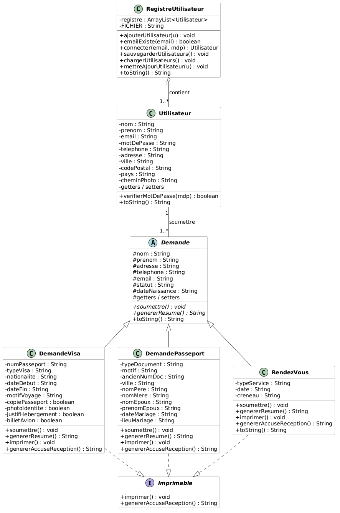

# 🛂 Services consulaires — application desktop Java Swing


Application de bureau qui simplifie les démarches auprès d'un consulat : demande de visa, de passeport ou de carte d'identité, et prise de rendez-vous.

> Projet de session — cours **420-A07 Programmation par composants I** — Collège de Bois-de-Boulogne, AEC Analyste-programmeur, 2026.
> Réalisé en équipe : **Hanen Chtourou** et **Sana Bahrini**.

---

## ✨ Fonctionnalités

- Création de compte et connexion (validation des champs)
- Tableau de bord récapitulatif des demandes
- Demande de **visa** et demande de **passeport / carte d'identité**
- **Prise de rendez-vous** : type de service, date et créneau
- Profil personnel
- **Accusé de réception** imprimable pour chaque demande
- Sauvegarde des données dans des fichiers texte (`~/consulaire/`)

## 🧠 Concepts de programmation orientée objet

- **Classe abstraite** `Demande`, spécialisée par `DemandeVisa` et `DemandePasseport` (héritage, polymorphisme)
- **Interface** `Imprimable` pour la génération des accusés de réception
- **Encapsulation** et classe utilitaire `Validateur`
- Séparation en packages : modèle / interface / entrées-sorties / contrôle

## 📁 Structure

```
src/
├── control/   Main.java                 # Point d'entrée
├── modele/    Demande, DemandeVisa, DemandePasseport, RendezVous,
│              Utilisateur, RegistreUtilisateur, Imprimable
├── ui/        LoginView, EnregistreView, MenuView (Swing, CardLayout)
├── io/        FichierManager            # Lecture / écriture des fichiers
└── utils/     Validateur                # Validation des saisies
```

## 🗺️ Diagramme de classes



## 🚀 Exécution

Prérequis : JDK 17+ et Apache NetBeans (projet Ant).

1. Cloner le dépôt :
   ```bash
   git clone https://github.com/hanen91-ch/services-consulaires-java-swing.git
   ```
2. Dans NetBeans : **File → Open Project**, choisir le dossier.
3. Clic droit sur le projet → **Run** (classe principale : `control.Main`).

## 👩‍💻 Auteures

- **Hanen Chtourou** — [GitHub](https://github.com/hanen91-ch) · [LinkedIn](https://linkedin.com/in/hanen-chtourou-45097a104)
- **Sana Bahrini** — [GitHub](https://github.com/SanaBH25)
